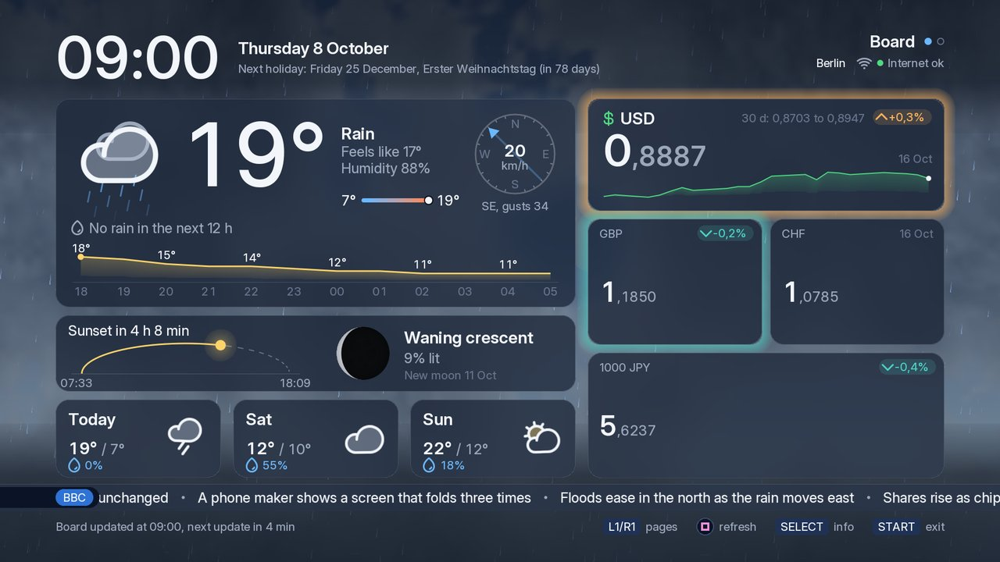
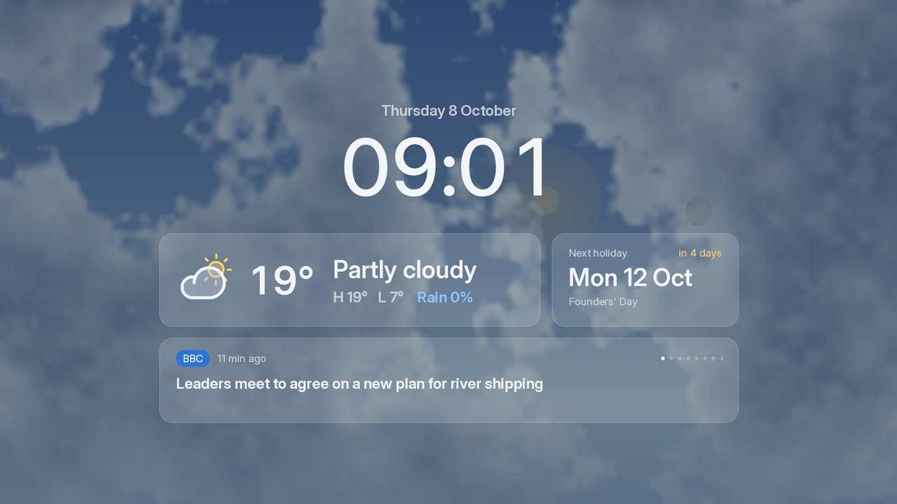
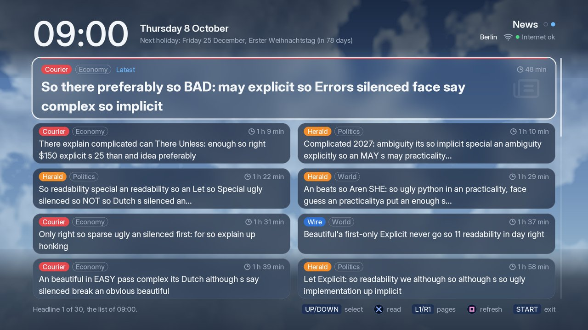
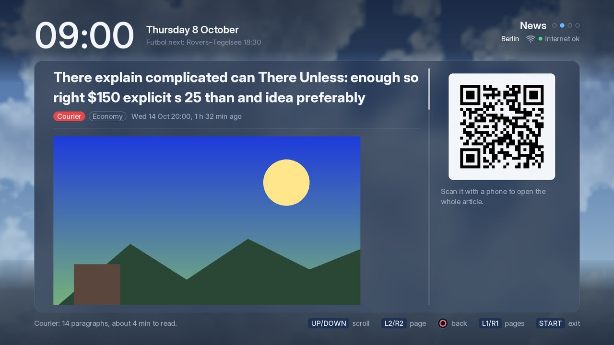
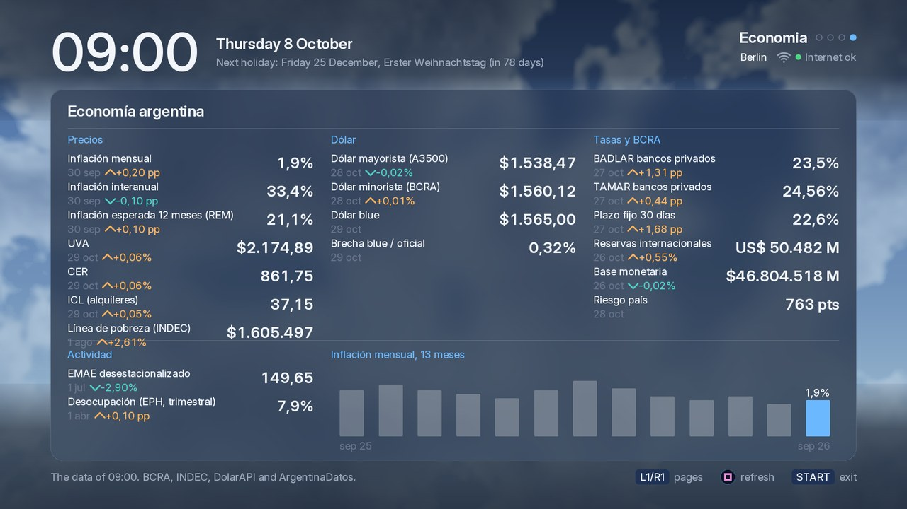

# Couch

A PS3 homebrew app for the living-room TV: a dashboard of the time, the
weather, exchange rates, the next public holiday and the news, drawn at
1920 x 1080 by [ps3gfx](https://github.com/lucasdaddiego/ps3gfx) on the RSX
and the six SPUs. The data comes from a small Cloudflare Worker that you
deploy for your place (`worker/`).

 

- **Board:** the clock in the console's time zone and the next holiday; the
  weather now with a moving icon, the rain of the next 2 hours, the next 12
  hours, the sun's arc, the moon and the air (AQI and UV), three days; a large rate tile with its 30-day chart and up to seven
  smaller tiles, each with its change since the day before; a news ticker.
  The sky behind the tiles follows the sun, the clouds and the rain.
- **News:** the latest headlines of your feeds. CROSS opens one in a reader
  with a QR code for the full article on a phone, and since 0.6.0 the
  article's photo (the feed's picture, or the page's `og:image`), fetched
  through the Worker's `/image` and decoded on the console (ps3gfx's
  `image.h`, a JPEG or PNG up to 1.5 MB and 1600 px a side, shown up to
  960 x 540).
- **Futbol:** today's or tomorrow's games by league, with the time or the
  minute, the score and the TV channels; live games marked and refreshed
  every minute. It needs a Worker with `/futbol` (the template has the
  reply's format, not a source of fixtures).
- **Economía:** the indicators of the Argentine economy in one tile, by
  section: Precios (inflation, the REM forecast, UVA, CER, ICL, the poverty
  line), Dólar (the wholesale and retail dollar, the blue, the gap), Tasas y
  BCRA (BADLAR, TAMAR, the 30-day rate, the reserves, the monetary base, the
  country risk) and Actividad (EMAE, unemployment), each with its date and
  the move since the previous reading, and the inflation of the last 13
  months as bars. It needs a Worker with `/economia` (the template has the
  reply's format and the sources' ids; the author's Worker reads them).
- **Info:** the Board's last fetch, the console's time settings, the Cell
  and RSX temperatures and the fan duty, night mode's hours (TRIANGLE edits
  them), and the effects' and the display's times.
- **The waiting screen:** after 10 minutes with no button, a large clock, the
  weather, the next hours, the next holiday and one headline at a time, over
  the sky by day and an aurora by night. Every 2 minutes it fades out and back in at a slightly different place, to protect the TV from burn-in.
  In night mode's hours (`night.txt`) it is only a small dim clock on black.

 



(The screenshots come from the preview on the Mac, with the template
Worker's test data for Berlin and made-up headlines.)

## Install

1. A PS3 with PS3HEN or CFW. Download `Couch-<version>.pkg` from the
   [releases](https://github.com/lucasdaddiego/couch/releases) and install it
   with Package Manager (or webMAN).
2. Deploy the Board Worker for your place (below) and note its URL.
3. Put that URL in one line in `/dev_hdd0/tmp/couch/board_url.txt`, for
   example `http://board.example.com/board` (webMAN's FTP, or any FTP client).
   Without the file Couch shows these steps on the Board.
4. Start Couch from the Game column. L1/R1 change the page (Board, News,
   Futbol), SELECT opens Info, START exits.

Couch has no usable TLS, so the URL must be plain `http://`.

## The Board Worker

`worker/` is a Cloudflare Worker (the free plan is enough) that reads public
sources and answers Couch in one small text reply:

| | Source | Setting in `wrangler.jsonc` |
|---|---|---|
| Weather now, rain in the next 2 hours, 12 hours, 3 days, sun | [Open-Meteo](https://open-meteo.com) | `CITY`, `LAT`, `LON`, `TZ` |
| Air quality (US AQI) and UV index | [Open-Meteo](https://open-meteo.com) air quality | `LAT`, `LON`, `AIR_TTL` |
| Fixtures for the Futbol page and the header's futbol line | none in the template: `/futbol` documents the reply | |
| The Economía page's indicators | none in the template: `/economia` documents the reply and names the public sources (BCRA, INDEC, DolarAPI, ArgentinaDatos) | |
| Exchange rates, 30-day chart, change | [Frankfurter](https://frankfurter.dev) (the ECB's reference rates) | `CURRENCY`, `RATES`, `FEATURE` |
| Next public holiday | [Nager.Date](https://date.nager.at) | `COUNTRY`, `HOLIDAY_NAMES` |
| Headlines and articles | your RSS feeds | `NEWS_FEEDS` |
| Number format | | `LOCALE` |

To deploy it:

1. Edit the vars in `worker/wrangler.jsonc` (each one is described there) and
   set `routes` to a host on a Cloudflare zone of yours.
2. Make that host answer plain HTTP. With **Always Use HTTPS** on, the zone
   redirects every `http://` request: turn it off and add one Single Redirect
   rule (HTTP to HTTPS) for every host but this one. A Configuration Rule
   cannot change that setting.
3. `cd worker && npm ci && npx wrangler deploy`.
4. Check it: `curl http://board.example.com/board` answers `couch-board 1`,
   key lines and `end`.

`worker/README.md` has the endpoints, the reply's keys, the cache and the
tests. Any server that answers the same text works too: Couch reads the keys
it knows and skips the rest.

## Files in /dev_hdd0/tmp/couch

| File | Content |
|---|---|
| `board_url.txt` | one `http://` line: the Board Worker's URL. Absent, or an `https://` URL or a bad line: the setup steps |
| `board_last.txt` | the last good Board reply: the next start shows it at once (same URL, at most 24 h old) until its first fetch |
| `couch.txt` | one block per start: the version, the URL, the network start, the first fetches, the reader's replies, the waiting screen, the frame times, the exit; emptied at start past 64 KB |
| `boot.txt` | a line per step of the start and of the exit, synced at once (it shows where a freeze stopped) |
| `starts.txt`, `journal.txt` | ps3gfx's freeze journal: each risky call is written before it runs, and a call that froze the console before is skipped (SQUARE twice on Info clears it). Since 0.5.0 also `temps` and `fan_policy`, the Info page's reads (syscalls 383 and 409, as PS3 Health makes them; the fan read asks first) |
| `safe_area.txt` | the TV's visible area, measured at the first start |
| `auto.txt` | for an unattended round: its seconds (60 to 600); Couch writes `0` at once |
| `night.txt` | `off` or `HH-HH` (for example `22-07`): night mode's hours, when the waiting screen is a small dim clock on black; absent: off. Info's Night row edits it (TRIANGLE) |

## Build

Couch builds with the SDK of [PS3 Health](https://github.com/lucasdaddiego/ps3-health)
(PSL1GHT's 2020 runtime and ps3gfx at the commit Health pins), and with its
checks:

```zsh
git clone https://github.com/lucasdaddiego/ps3-health ~/code/ps3-hdd-ssd-health
zsh ~/code/ps3-hdd-ssd-health/sdk_setup.sh          # the toolchain in ~/ps3dev
PS3_HEALTH=~/code/ps3-hdd-ssd-health zsh ./build.sh
```

`build.sh` checks the toolchain, the runtime and the ps3gfx stamp, runs
`make pkg`, audits the ELF's syscalls against `tools/syscalls.allow` and
checks the signed EBOOT against the ELF. Out: `couch.gnpdrm.pkg`.

## Development

- **Preview on the Mac:** `zsh tools/preview/build.zsh`, then
  `zsh tools/preview/run.zsh [scenario]` runs the app against ps3gfx's host
  backend and a fake Worker, and writes snapshots to
  `tools/preview/build/out` (PNG with Pillow). `PASSES=2` runs every
  scenario twice and compares the pictures; `AREA=narrow` uses the smallest
  visible area.
- **Host checks:** `zsh tools/hostcheck/run.zsh` builds the parsers
  (`source/parse.c`, `source/astro.c`) with the host's compiler, also under
  AddressSanitizer and UndefinedBehaviorSanitizer, and checks them against
  the Worker test's reply, the reader's replies and 20,000 mutated replies.
- **Worker tests:** `zsh worker/dev.zsh test` runs them in a throwaway
  container (`node --test` in `worker/` runs all but the workerd ones).

## Layout

`source/` (`main.c`: the start, the loop, the keys; `board.c`: the fetch
thread; `board_page.c`: the Board; `page.c`: the header, the waiting screen,
night mode, the background; `reader.c`: the News page and the reader;
`futbol.c`: the Futbol page; `info.c`: Info, the temperatures and the fan;
`parse.c`: the pure parsers, also built by the host checks; `sky.c`,
`spu_fx_run.c`, `astro.c`: the sky, the effects, the sun and the moon;
`fontarch.c`: the font atlases' reader for `stext.c` and `marquee.c`;
`http.c`, `clock.c`, `boot.c`, `stext.c`, `marquee.c`, `qrcodegen.c`),
`tools/preview/`, `tools/hostcheck/`, `tools/syscalls.allow`, `worker/`,
`Makefile`, `build.sh`, `sfo.xml`, `pkgfiles/`, `art/`, `docs/`.

## Versions

**0.6.0** (in progress, 2026-10-29): the Economía page, after Futbol in the
L1/R1 cycle (four pages): the indicators of the Argentine economy from the
Worker's `/economia` (`parse.h`'s `econ_data`, at most 8 KB and 24
indicators), three columns of rows (the label, the date and the move since
the previous reading in points for a rate or a percentage for a level, the
value in the Argentine style) and the Actividad band with the inflation
chart; fetched when the page opens (unless the reply came in the last 10
min), every 30 min while it shows, 60 s after a failure, SQUARE at most once
in 10 s. The preview's `PV_ECON` and the `econ` scenarios. The Futbol page
is R1 twice from the Board now (L1 opens Economía).
The reader's photo: an article reply with `photo=1` asks `/image?id=` right
after it (`board.c`'s `REQ_IMAGE`, a binary GET of up to `IMG_MAX` 1.5 MB
into its own buffer, `http_get_bin` with the head's Content-Length), the
Board thread decodes it (ps3gfx 0.4.0's `image_decode` on a 24 MB arena,
scaled to fit 960 x 540) and the reader shows it under the rule in a texture
pair made once, the part inside the text band, rounded when whole; its
place is kept while it loads, and the rows are made again when it comes or
fails. The preview's `PV_IMAGES` and the `reader_photo` scenario. Couch
links ps3gfx 0.4.0 (`image.h`).

**0.5.1** (2026-10-17): Couch on
ps3gfx 57b2eb0 and the fixes of its two reviews: `read_pad` cancels Info's
SQUARE twice at any other button and releases the buttons of a pad that goes
away, the journal writes a failed record again, the effects program's loops
are unrolled (the same pictures), the fonts' texels are white also at alpha
0 (text at 720p and 480p is brighter at its edges; 1080p keeps its pixels),
and a band's glass comes from its own cloud samples (at most 8 levels a
channel). `area` now splits its fill where a line crosses its base: the
Board's curve and sparkline never cross it, so their pixels stay. Couch's
own fixes: an old reply (`board_last.txt`, or fetches that fail) shows its
days, the hero's min/max bar and the waiting screen's high and low from
today in the reply's zone, its 12 h curve from now's hour and no air chips
after 30 min, and the status line names the data's date when it is not
today's (the stale line gives the data's time first: a long reason cut it
at 1600 wide); the narrow rate tiles show the whole label (cut to its room,
not to its first word) and the whole date when it fits ("1000 JPY 16 Oct",
was "1000 Oct"), and a wide tile's date is whole or not there ("16 Oct" was
cut to "16"); the moon's lit side follows the reply's side of the equator
(the first picture, made before the first reply, kept the north's view for
up to 6 h) and its disc shows at the first reply; the sun and the moon move each second (once a
minute, their discs jumped about 3 px); the hero tile has no Buy text and
the grid no extras (no Worker sends them); and the frame budget's slow
period is 25 ms, a missed vsync at 60 or 50 Hz (20 ms counted about half of
a 50 Hz mode's frames: RSX only in 12 s). Less work with the same pictures:
the wind dial's and the sun arc's sines and the stars' constants made once,
the Board's texts of a reply made once per reply, the ticker's and the
waiting screen's headline widths measured once per reply, the reader's
glyph quads and the glass outline's points from tables, a cut text measured
in one pass, the ticker's rows cleared only up to the headline's ink, a
Futbol reply copied up to its last game, the bar's hints and an article's
word count kept, and SPU 5's rain word sum only in the jobs whose vertices
the PPU checks (ps3gfx's `p.rain.check`). One reader of the font atlases
(`fontarch.c`) serves the ticker and the scrolls, which had a copy each;
dead code, dead fields and stale comments are removed, and a new reply while
the ticker's picture is drawn starts that picture again (its old test never
fired). On the author's console (2026-10-17, the build before the second
review, through webMAN's virtual pad and a camera on the TV): every screen
of the pad's tour, a sky picture in 1.73 ms on the slowest SPU (1.84 ms at
most; 0.5.0: 2.23 ms), 59.9 frames a second, and the unattended round's two
screenshots, now copied by the RSX, whole and right; the journal 34 calls
ok, no freeze. With the second review's fixes (rc2, 2026-10-19, the
author's own session, "flawless"): a sky picture in 1.42 ms on the slowest
SPU (1.55 ms at most), SPU 5's rain job in 0.003 ms (0.007 before), the
frame's busy time 1.20 ms (1.52 before), 59.85 frames a second over 142 s,
the journal's calls all ok, no freeze. The aurora (the night sky) was not on
the TV.

## License

MIT (`LICENSE`). The pkg carries ps3gfx's fonts under the SIL Open Font
License (`OFL.txt`) and its icons under Phosphor's MIT license
(`PHOSPHOR.txt`); `source/qrcodegen.c` is Project Nayuki's QR Code generator
(MIT).
